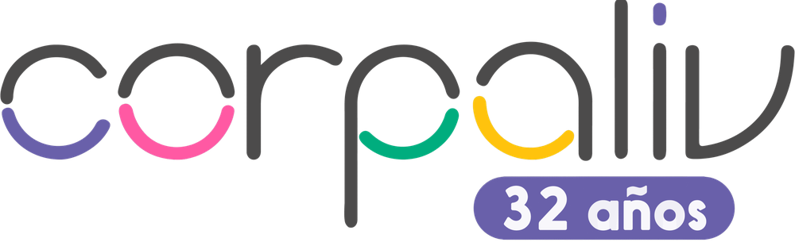

<p align="center">
  
</p>

<h1 align="center">CORPALIV · Aplicación móvil</h1>

<p align="center">
  Inclusión social y laboral de personas con discapacidad múltiple, ahora también en tu teléfono.
</p>

<p align="center">
  
  
  
  
</p>

<p align="center">
  
  
  
  
</p>

---

## Índice

1. [Integrantes](#integrantes)
2. [¿De qué trata el proyecto?](#de-qué-trata-el-proyecto)
3. [Funcionalidades](#funcionalidades)
4. [Recursos nativos del teléfono](#recursos-nativos-del-teléfono)
5. [Tecnologías usadas](#tecnologías-usadas)
6. [Cómo está organizado el proyecto](#cómo-está-organizado-el-proyecto)
7. [Microservicios (backend)](#microservicios-backend)
8. [Endpoints](#endpoints)
9. [API externa](#api-externa)
10. [Cómo ejecutar la app](#cómo-ejecutar-la-app)
11. [Cómo ejecutar el backend](#cómo-ejecutar-el-backend)
12. [Pruebas unitarias](#pruebas-unitarias)
13. [APK firmado](#apk-firmado)
14. [Cosas que faltan por mejorar](#cosas-que-faltan-por-mejorar)

---

## Integrantes

| Integrante | Rol |
|---|---|
| **Javiera Faundez** | Desarrollo de la app y del backend |
| **Dominga Ruiz** | Desarrollo de la app y del backend |

## ¿De qué trata el proyecto?

**CORPALIV (Alba Lab)** es una organización sin fines de lucro que trabaja por la inclusión social y laboral de personas con discapacidad múltiple.

Hicimos una app móvil para que empresas y personas que quieran ayudar puedan:

- **Conocer** qué hace la organización, sus programas, productos e impacto.
- **Colaborar** enviando una solicitud (donación, voluntariado, alianza, compra, capacitación u otro).
- **Seguir** en qué estado va su solicitud, usando un código de seguimiento.
- **Escribir** al equipo por el formulario de contacto.

El equipo de CORPALIV (gestores) entra con correo y clave para revisar las solicitudes y cambiarles el estado.

> [!NOTE]
> Es un MVP (una primera versión), no una app lista para publicar. Todos los datos que aparecen son **ficticios**, de ejemplo.

> [!IMPORTANT]
> **Estado actual:** la app está conectada a los 4 microservicios con **Retrofit**: programas, productos e impacto se leen del servidor; las solicitudes y mensajes de contacto se envían al servidor; y el gestor inicia sesión con un token JWT. Si el servidor no responde, programas, productos e impacto muestran datos de respaldo y un aviso con botón **Reintentar**. Room y DataStore se mantienen para la copia local de "Mis solicitudes", el perfil y la accesibilidad. Además usa una **API externa** (feriados de Chile).

## Funcionalidades

| Pantalla | Qué permite hacer |
|---|---|
| **Bienvenida** | Pantalla inicial con el logo y qué se puede hacer en la app. Tiene un botón discreto de "Acceso gestores" para el equipo. |
| **Inicio** | Mensaje de bienvenida, cifras de ejemplo y botones para ir a Colaborar y a Contacto. |
| **Quiénes somos, Programas, Productos e Impacto** | Tarjetas que se expanden, filtro por categoría, historias e indicadores de impacto. Programas, Productos e Impacto vienen de los microservicios (con datos de respaldo si no hay conexión). |
| **Colaborar** | Formulario con nombre, correo o teléfono, mensaje (se puede **dictar por voz**), tipo de colaboración, monto (solo si es donación), fecha opcional, contacto prioritario y política de privacidad. Cada campo se valida y muestra un ícono y un mensaje si hay un error. Arriba muestra los **próximos feriados de Chile** (API externa) para ayudar a elegir la fecha. Al enviar, el servidor entrega un **código de seguimiento** que se puede copiar. |
| **Mis solicitudes** | Lista de las solicitudes enviadas con su estado y el mensaje del equipo; el botón **Actualizar estados** pregunta al servidor el estado actual. Se puede consultar una solicitud escribiendo su código. También muestra los mensajes enviados por Contacto, con botón para eliminar. |
| **Contacto** | Formulario con nombre, correo, mensaje y casilla de privacidad, también con validaciones. El mensaje llega al servidor como una solicitud de tipo "Otro". |
| **Perfil** | Guarda nombre y correo o teléfono (rellenan solos los formularios) y permite elegir una imagen desde la galería o tomarla con la cámara. |
| **Acceso gestores** | Login para el equipo de CORPALIV (contra `ms-admin`). Dentro, el gestor ve **todas las solicitudes del servidor**, les cambia el estado, deja un mensaje o las elimina. |
| **Configuración** | Accesibilidad (por ejemplo lectura en voz alta y alto contraste) y preferencia de novedades. Se abre con el engranaje, al final del menú lateral. |
| **Navegación** | Menú lateral con grupos e íconos y barra inferior (Inicio, Colaborar, Contacto). |
| **Animaciones** | Transición suave entre pantallas, mensajes de éxito que aparecen y desaparecen, íconos de error e indicador de carga al guardar. |

### Estados de una solicitud

<p>
  
  
  
  
  
</p>

> [!TIP]
> Los estados **Concretado** y **Descartado** son finales: una vez puestos, la solicitud ya no se puede modificar.

## Recursos nativos del teléfono

| Recurso | Para qué se usa |
|---|---|
| Cámara | Tomar la imagen del perfil (pide permiso al usuario) |
| Galería | Elegir la imagen del perfil |
| Dictado por voz | Dictar el mensaje de Colaborar (reconocedor de voz de Android) |
| Lectura en voz alta | Escuchar textos de la app (Text-to-Speech) |

## Tecnologías usadas

**App Android**

<p>
  
  
  
  
  
  
  
  
  
  
</p>

**Backend** (repositorio aparte: [AplicacionCORPALIVBackend](https://github.com/domimoly/AplicacionCORPALIVBackend))

<p>
  
  
  
  
  
  
  
</p>

**Organización**

<p>
  
  
  
</p>

Enlace al tablero de Trello: **[pendiente]**

## Cómo está organizado el proyecto

Dentro de `app/src/main/java/com/example/aplicacioncorpaliv/`:

| Carpeta | Contenido |
|---|---|
| `model/` | Datos de los formularios, tipos de colaboración, estados, código de seguimiento y **validaciones** (`Validaciones.kt`) |
| `data/` | Base de datos Room, DataStore, repositorios y cámara |
| `data/remote/` | Retrofit: direcciones (`ApiConfig`), interfaces de cada servicio y de la API externa, y mensajes de error |
| `viewmodel/` | La lógica de cada pantalla |
| `ui/screens/` | Las pantallas |
| `ui/componentes/` | Menú lateral, barra superior y otros componentes |
| `ui/theme/` | Colores y tema (sacados del logo de CORPALIV) |

## Microservicios (backend)

| Servicio | Puerto | Base de datos | Qué hace |
|---|---|---|---|
| `ms-admin` | 9093 | `bd_admin` | Login, usuarios y roles. Es el único que firma los tokens JWT |
| `ms-contenidos` | 9091 | `bd_contenidos` | Programas, historias e indicadores de impacto |
| `ms-vinculacion` | 9092 | `bd_vinculacion` | Solicitudes de colaboración, tipos y seguimiento |
| `ms-catalogo` | 9094 | `bd_catalogo` | Categorías, productos y servicios |

Cada servicio valida el token por su cuenta. La documentación de cada uno está en `http://localhost:<puerto>/doc/swagger-ui.html`.

## Endpoints

Los que dicen **token** requieren el encabezado `Authorization: Bearer <token>`.

 consulta ·
 crea ·
 edita ·
 cambia una parte ·
 elimina

### ms-admin · puerto 9093

| Método | Ruta | Acceso | Descripción |
|---|---|---|---|
|  | `/auth/login` | público | Entrega el token (correo y clave) |
|   | `/usuarios` | token de ADMIN | Lista y crea usuarios |
|    | `/usuarios/{id}` | token de ADMIN | Consulta, edita y elimina un usuario |
|  | `/roles` | token de ADMIN | Lista de roles |

### ms-contenidos · puerto 9091

| Método | Ruta | Acceso | Descripción |
|---|---|---|---|
|  | `/programas`, `/programas/{id}` | público | Programas publicados |
|  | `/historias`, `/historias/{id}` | público | Historias de impacto |
|  | `/indicadores`, `/indicadores/{id}` | público | Indicadores de impacto |
|  | `/programas/{id}/exists` | público | Lo usa ms-vinculacion |
|  | `/programas/admin`, `/historias/admin`, `/indicadores/admin` | token | Lista completa, incluye borradores |
|  | `/programas`, `/historias`, `/indicadores` | token | Crear |
|   | `/programas/{id}`, `/historias/{id}`, `/indicadores/{id}` | token | Editar y eliminar |

### ms-vinculacion · puerto 9092

| Método | Ruta | Acceso | Descripción |
|---|---|---|---|
|  | `/solicitudes` | público | Crea una solicitud y devuelve su código de seguimiento |
|  | `/solicitudes/seguimiento/{codigo}` | público | Estado de una solicitud (sin datos personales) |
|  | `/tipos-colaboracion` | público | Tipos de colaboración |
|  | `/solicitudes` (filtro opcional `?estado=`), `/solicitudes/{id}`, `/solicitudes/{id}/historial` | token | Consulta para el gestor |
|  | `/solicitudes/{id}/estado` | token | Cambia el estado y deja el historial |
|  | `/solicitudes/{id}` | token | Elimina la solicitud y su historial |

### ms-catalogo · puerto 9094

| Método | Ruta | Acceso | Descripción |
|---|---|---|---|
|  | `/productos`, `/productos/{id}`, `/categorias`, `/categorias/{id}` | público | Catálogo |
|  | `/productos/{id}/exists` | público | Lo usa ms-vinculacion |
|  | `/productos/admin` | token | Lista completa del catálogo |
|  | `/productos`, `/categorias` | token | Crear |
|   | `/productos/{id}`, `/categorias/{id}` | token | Editar y eliminar |

## API externa

La app consulta **Nager.Date**, una API pública y gratuita (no pide clave) que entrega los feriados de cada país. Se muestra en la pantalla **Colaborar** como tarjeta "Próximos feriados en Chile".

| Método | URL | Descripción |
|---|---|---|
|  | `https://date.nager.at/api/v3/PublicHolidays/{año}/CL` | Feriados públicos de Chile del año indicado |

Se usa con su propio Retrofit, repositorio y ViewModel, **separados** de los microservicios y de Room: si la API falla (sin internet o servicio caído), solo se muestra un aviso con **Reintentar** y el resto de la app sigue funcionando.

## Cómo ejecutar la app

1. Tener instalado **Android Studio**.
2. Descargar o clonar este repositorio y abrir la carpeta con Android Studio.
3. En `File > Settings > Build, Execution, Deployment > Build Tools > Gradle`, elegir **JDK 21** en "Gradle JDK".
4. Esperar que termine el **Sync** de Gradle.
5. Dejar **encendidos los 4 microservicios** (ver la sección anterior). Sin ellos la app igual abre, pero muestra avisos de conexión y datos de respaldo.
6. Crear o abrir un emulador (Android 7.0 / API 24 o superior) y presionar **Run**. El emulador llega al computador con la dirección `10.0.2.2`, que está en `data/remote/ApiConfig.kt`.
7. Para probar en un **celular real**: conectarlo a la misma red WiFi del computador y cambiar `HOST` en `ApiConfig.kt` por la IP del computador (por ejemplo `"192.168.1.15"`).

> [!WARNING]
> Con Java 25 en "Gradle JDK" da error. Si ya tenías instalada una versión anterior de la app, desinstálala antes, porque la base de datos cambió.

**Cuenta de prueba del gestor (ficticia, la crea el backend):** `gestor@ejemplo.cl` / `Gestor2026`

## Cómo ejecutar el backend

1. Instalar **JDK 17** o superior (el proyecto está configurado para Java 17; también corre con Java 21) y **MySQL** (por ejemplo con XAMPP) (usuario `root` sin clave, o cambiar los datos en el `application.properties` de cada servicio).
2. Clonar el repositorio [AplicacionCORPALIVBackend](https://github.com/domimoly/AplicacionCORPALIVBackend). Cada servicio es un proyecto Maven independiente.
3. Abrir una terminal en la carpeta de cada servicio y ejecutar (en Windows `mvnw.cmd spring-boot:run`):

```bash
./mvnw spring-boot:run
```

4. Orden recomendado: `ms-admin`, `ms-contenidos`, `ms-catalogo` y por último `ms-vinculacion` (este consulta a `ms-contenidos` y `ms-catalogo`). Las bases de datos y los datos de ejemplo se crean solos al iniciar.
5. Probar en Swagger: primero `POST /auth/login` en ms-admin con `gestor@ejemplo.cl` / `Gestor2026`, copiar el token y pegarlo en el botón **Authorize** de cada servicio.
6. Para el emulador, la app llama a `http://10.0.2.2:<puerto>` (así el emulador llega al computador).

Para ejecutar las pruebas de un servicio: `./mvnw test`.

## Pruebas unitarias

Se probaron los **ViewModels y Repositories** con **JUnit 4**, **MockK** (objetos falsos de la API, del DAO y del DataStore) y **kotlinx-coroutines-test**. Los tests están en `app/src/test/`.

Cobertura medida con **JaCoCo** (reporte `app/build/reports/coverage/test/debug/index.html`):

| Paquete / clase | Cobertura de instrucciones |
|---|---|
| `viewmodel` (todos los ViewModels) | **90%** |
| `RegistroRepository` | **94%** |
| `GestorRepository` | **81%** |

Para ejecutarlas desde la terminal, en la carpeta del proyecto Android:

```bash
./gradlew testDebugUnitTest
./gradlew createDebugUnitTestCoverageReport
```

## APK firmado

| Elemento | Enlace o archivo |
|---|---|
| APK firmado (release) | [`app/release/app-release.apk`](app/release/app-release.apk) |
| Archivo `.jks` (en el repositorio) | [`corpaliv.jks`](corpaliv.jks) |
| Captura de la generación del APK firmado | **[pendiente]** |

Datos del `.jks` (clave de uso académico, no protege nada real): alias `corpaliv`, clave del almacén y de la clave `corpaliv2026`.

## Cosas que faltan por mejorar

- [ ] Guardar la sesión del gestor al cerrar la app (hoy el token vive solo en memoria).
- [ ] Guardar en el teléfono los programas, productos e impacto para verlos sin conexión (hoy se usan datos de respaldo fijos).
- [ ] Permitir al gestor crear y editar programas y productos desde la app (hoy los endpoints existen, pero solo se usan desde Swagger).
- [ ] Guardar la imagen del perfil al cerrar la app.
- [ ] Cambiar los datos de ejemplo por información real autorizada por la organización.

---

<p align="center">
  <sub>Proyecto académico · DSY1105 · Duoc UC · Todos los datos son ficticios</sub>
</p>
